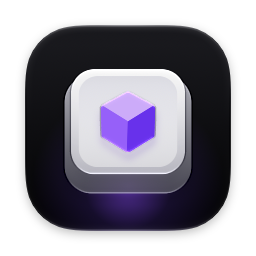
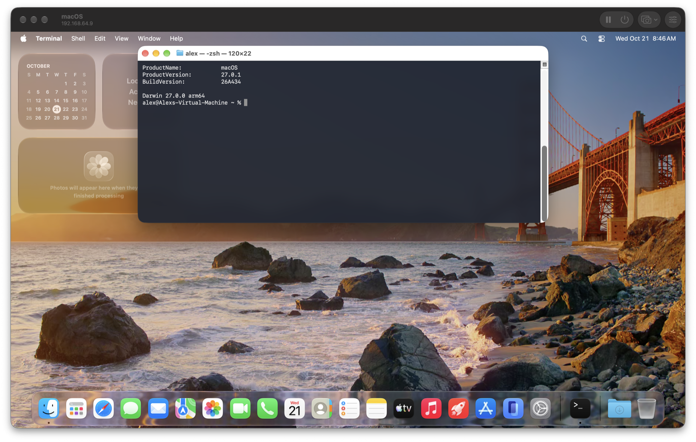

<p align="center">
  
</p>

# Hyperbox

A native macOS app for running macOS and Linux virtual machines on your Mac.



## What it does

- **Installs in one click.** macOS comes straight from Apple, and on macOS 27 it sets itself up with no Setup Assistant. Ubuntu, Fedora and Debian install on their own and start at a signed-in desktop. You can also boot any ISO or IPSW.
- **Feels like part of your Mac.** The clipboard works both ways, you can drop files onto a machine, Mac folders show up in the guest, and sound and the microphone pass through. The display follows the window, up to 5K, with Metal graphics in macOS guests.
- **Snapshots in seconds**, whether the machine is running or not. They take space only as the machine changes. Quitting suspends a machine, and it picks up where it left off.
- **Each machine runs as its own app**, with its own Dock icon, so a crash takes down only that machine.
- **Port forwarding** reaches a web server or SSH in a guest through a port on your Mac. Shared folders, the network and port forwards change while the machine runs.
- **Moves in one piece.** A machine is one file, so it copies to another Mac. Duplicates take no space until they change. It imports Parallels and UTM machines, and qcow2 and VMDK disks.
- **AI agents get their own machines.** Hyperbox's MCP server lets Claude Code, Codex, Cursor and others see the screen, use the machine's own keyboard and mouse, and run commands, as a user or as root. They never touch your Mac's screen, so Hyperbox needs no Accessibility or Screen Recording permission. Add it to your agents in one click under **Settings › Agents**, and turn it off for any machine.
- **Runs Docker containers** without Docker Desktop, using the usual `docker` command, Compose and Testcontainers. The engine starts with your first container and stops when none are left. Run `hyperbox containers setup` to point Docker at it.

## Installation

### Download

Get `Hyperbox-<version>.dmg` from the [latest release](https://github.com/alexisbcz/hyperbox/releases/latest), open it, and drag Hyperbox into Applications. It needs a Mac with Apple silicon on macOS 26 or later.

The app isn't notarized, so macOS blocks the first launch. Allow it under **System Settings › Privacy & Security › Open Anyway**, or run:

```sh
xattr -dr com.apple.quarantine /Applications/Hyperbox.app
```

To get the `hyperbox` command, use **Hyperbox › Install ‘hyperbox’ Command in PATH**.

Hyperbox updates itself: it checks for a new release once a day and asks before installing it. Check by hand with **Hyperbox › Check for Updates…**, or let it install updates in the background under **Settings › General › Updates**.

### Build from source

```sh
curl -fsSL https://raw.githubusercontent.com/alexisbcz/hyperbox/main/install.sh | bash
```

It also links the `hyperbox` command into your PATH.

## The `hyperbox` command

```sh
hyperbox list                         # your machines, their state and address
hyperbox start ubuntu --wait          # boot one and wait for its address
hyperbox ssh ubuntu                   # as the user Hyperbox created
hyperbox forward ubuntu 8080:80       # then open http://localhost:8080
hyperbox exec ubuntu -- uname -a      # run a command in the guest
hyperbox snapshot ubuntu "clean"      # and later: hyperbox restore ubuntu clean
hyperbox mcp                          # the MCP server, for agents
```

Run `hyperbox --help` for the rest.

## Releasing

1. Set `MARKETING_VERSION` in `project.yml` to the new version, so builds from source know which release they match.
2. Tag it and push the tag:

   ```sh
   git tag v0.2.0 && git push origin v0.2.0
   ```

The Release workflow builds the DMG, signs it for Sparkle, and publishes it with an `appcast.xml`, which installed copies read from the latest release. Signing needs the `SPARKLE_PRIVATE_KEY` repository secret, the private half of the `SUPublicEDKey` in `Hyperbox/Info.plist`. Sparkle's `generate_keys --account hyperbox` (in `build/SourcePackages/artifacts/sparkle/Sparkle/bin` after a build) keeps it in your keychain; `generate_keys --account hyperbox -x key.txt` exports it. Keep a backup: without it, installed copies can't take updates.

`make dmg` builds the same DMG locally.

[MIT License](LICENSE)
